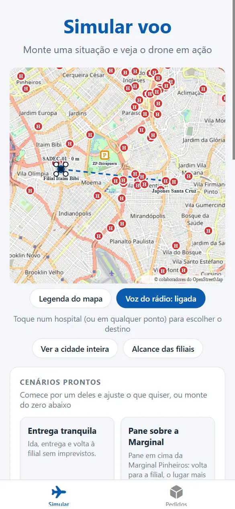
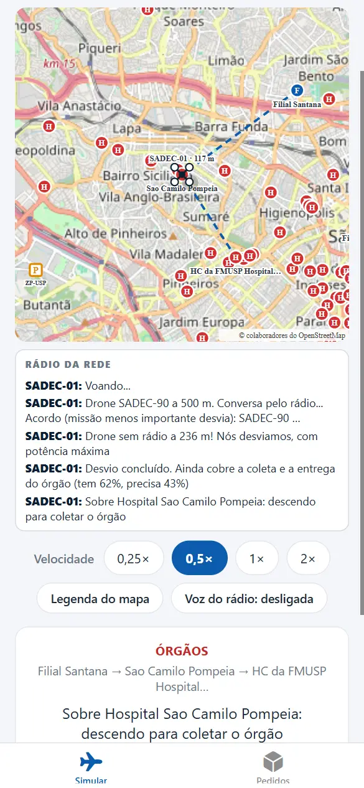
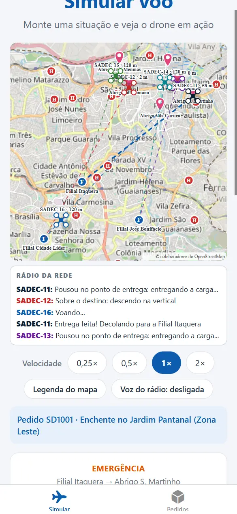
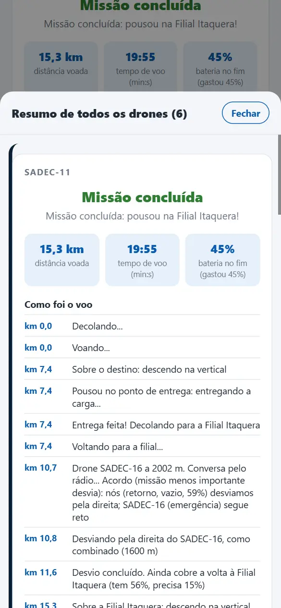
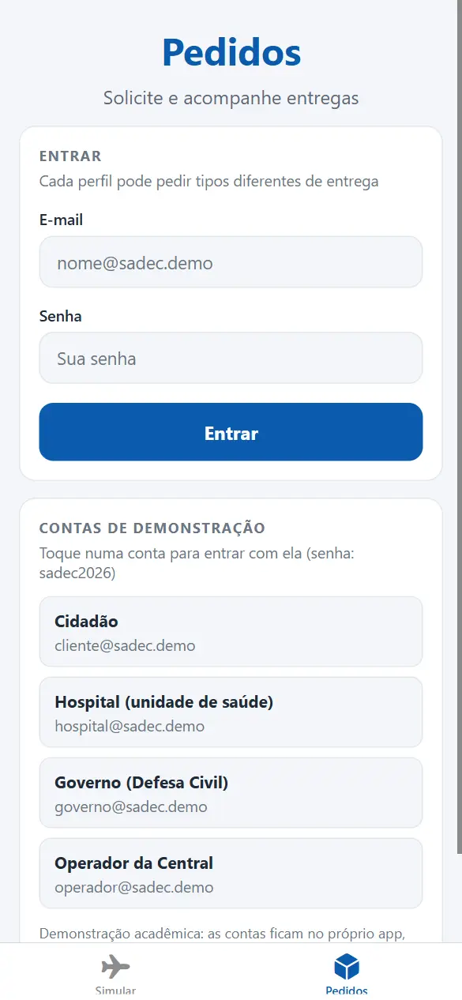
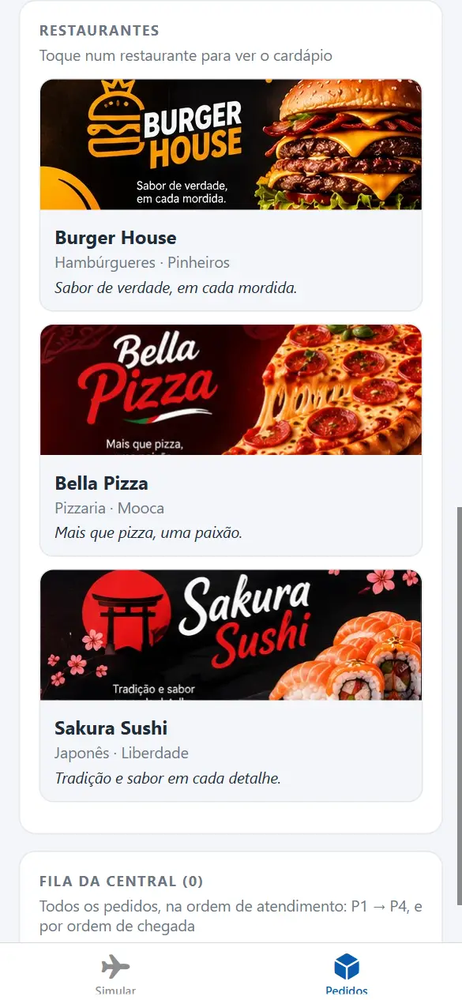
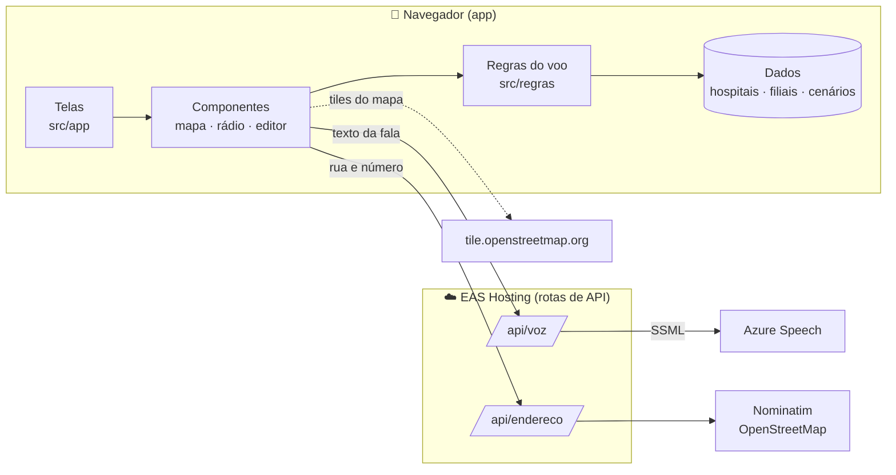

<div align="center">

# 🚁 SADEC — Aplicativo
### Simulador da rede de drones do Sistema Autônomo de Drones de Entrega e Cuidado

**Monte qualquer situação, de uma entrega tranquila a uma enchente com seis drones no ar, e veja os drones decidirem sozinhos no mapa real de São Paulo, conversando pelo rádio.**


### [▶️ Abrir o aplicativo no computador](https://sadec.expo.app)

[O app](#-o-app) •
[Testar agora](#-testar-agora) •
[Telas](#️-telas) •
[Funcionalidades](#-funcionalidades) •
[Regras do drone](#-regras-do-drone) •
[Arquitetura](#️-arquitetura) •
[Como executar](#️-como-executar) •
[Equipe](#-equipe)

</div>

---

## 📱 O app

O **SADEC** é uma rede de drones autônomos que leva **órgãos para transplante**, **ajuda em emergências** e **remédios**, sustentada por **entregas comerciais** feitas nas mesmas rotas (subsídio cruzado). Este repositório é o **aplicativo** do projeto: um simulador em que dá para montar um cenário e ver, passo a passo, como o drone reage a panes, falta de GPS, vento, obstáculos e outros drones.

O app tem duas abas:

| Aba | O que faz |
|---|---|
| **Simular** | Escolha o destino no mapa (busca por hospital ou por endereço), o tipo de entrega, a bateria e os eventos de cada km da viagem. Depois é só iniciar e acompanhar o voo, o rádio e o resumo final. |
| **Pedidos** | Entre com um perfil (cidadão, hospital, Defesa Civil ou Central) e faça pedidos de delivery, remédios, órgãos ou socorro. Cada pedido vira um voo no simulador. |

Tudo acontece no **mapa real da cidade de São Paulo**: contorno oficial do IBGE, **180 hospitais** do CNES e **23 filiais** posicionadas por algoritmo para que toda a área urbana tenha pelo menos duas filiais a até 10 km.

## 📲 Testar agora

<table>
<tr>
<td align="center" width="50%">

**No celular**


Aponte a câmera para o QR code.

</td>
<td align="center" width="50%">

**No computador**

### [sadec.expo.app](https://sadec.expo.app)

Abre direto no navegador, sem instalar nada.<br/>
Dica: o app foi pensado para celular. No computador, aperte <kbd>F12</kbd> e ative o modo de celular (<kbd>Ctrl</kbd>+<kbd>Shift</kbd>+<kbd>M</kbd>) para ver como no aparelho.

</td>
</tr>
</table>

> **Sugestão de roteiro (2 minutos):**
> 1. Na aba **Simular**, toque no cenário pronto **"Órgão no tráfego aéreo"** e em **Iniciar simulação**.
> 2. Ligue a **voz do rádio** e veja o drone combinar quem desvia com o outro drone.
> 3. Na aba **Pedidos**, toque em **Operador da Central**, peça a **Operação: enchente no Jardim Pantanal** e toque em **Ver o voo no simulador**: seis drones de três filiais no ar ao mesmo tempo.
> 4. No fim, abra **Ver o resumo de todos os drones**.

**Contas de demonstração** (todas com a senha `sadec2026`; também aparecem na própria tela de login):

| Perfil | E-mail | Pode pedir |
|---|---|---|
| Cidadão | `cliente@sadec.demo` | Saúde e comercial |
| Hospital | `hospital@sadec.demo` | Órgãos e saúde |
| Governo (Defesa Civil) | `governo@sadec.demo` | Emergência |
| Operador da Central | `operador@sadec.demo` | Tudo |

> As contas ficam no próprio app, sem servidor: servem para mostrar **quem pode pedir o quê**, não são um login seguro.

## 🖼️ Telas

<table>
<tr>
<td align="center" width="33%"><br/><sub><b>Montagem:</b> mapa real, destino e cenários prontos</sub></td>
<td align="center" width="33%"><br/><sub><b>Voo:</b> transporte de órgão com tráfego aéreo e rádio</sub></td>
<td align="center" width="33%"><br/><sub><b>Enchente:</b> seis drones de três filiais ao mesmo tempo</sub></td>
</tr>
<tr>
<td align="center"><br/><sub><b>Resumo:</b> distância, tempo, bateria e linha do tempo de cada drone</sub></td>
<td align="center"><br/><sub><b>Pedidos:</b> entrar com um perfil</sub></td>
<td align="center"><br/><sub><b>Delivery:</b> o pedido comercial que sustenta a operação</sub></td>
</tr>
</table>

## ✨ Funcionalidades

### Simulador
- **8 cenários prontos**, calibrados no mapa real: entrega tranquila, pane sobre a Marginal, falha grave com vento, motor falhando, GPS perdido, órgão no tráfego aéreo, guindaste e pássaros, volta difícil.
- **Destino em qualquer ponto da cidade:** busca de hospital (sem precisar de acento), **busca por endereço** (rua, avenida e número, pelo OpenStreetMap) ou toque no mapa em dois passos (aproximar → escolher).
- **Tipos de entrega** por prioridade: órgãos (coleta no hospital X e entrega no hospital Y), emergência, saúde e comercial.
- **Bateria** com verificação antes da decolagem: o drone só sai se a carga cobrir ida, volta e as descidas, com 30% de margem.
- **Editor de eventos** com linha do tempo: pane, falha grave, motor fraco, GPS, vento, bateria, temperatura, obstáculo (guindaste ou pássaros) e outro drone, cada um no km que você escolher. Com vários drones, cada evento pode acontecer **em qualquer um deles, ao mesmo tempo**.
- **Mapa de ruas real** (OpenStreetMap) com câmera automática que segue o drone e aproxima nos obstáculos; **pinça e arrastar** com o dedo (ou roda e arrasto do mouse) e botão para voltar à visão automática.
- **Rádio da rede:** as últimas 5 mensagens dos drones, com cor por drone.
- **Voz do rádio** com cara de aviação: voz neural do **Azure** (uma voz por drone, filtro de rádio e chiado de abertura) e a voz do próprio aparelho como reserva. A simulação **espera a fala** e o drone que está falando anda em câmera lenta, para a voz bater com o que aparece na tela.
- **Velocidade** ajustável (0,25× a 2×).
- **Resumo do voo** no fim (resultado, distância, tempo, bateria e como foi o voo) e, com vários drones, uma **aba que sobe com o resumo de todos**.

### Vários drones na rede
- Até **6 drones** voando ao mesmo tempo, cada um com a sua rota, se enxergando e **combinando pelo rádio quem desvia** (um acordo só, confirmado pelos dois).
- **Bolha de segurança na altura também:** não há desvio se um drone está descendo para entregar e o outro está lá em cima.
- Na **operação da enchente**, a ordem e o tempo de saída foram calculados simulando a tela inteira: dois drones por filial, um de cada vez, e cada drone **volta para a filial de onde saiu** (a mais próxima só se a bateria não der).

### Pedidos
- **Login por perfil**, com a regra de quem pode pedir cada tipo de entrega.
- **Delivery** (restaurantes com cardápio), **remédios** (farmácia, com caixa térmica quando precisa), **transporte de órgão** (com código de autorização da Central) e **socorro** (área atingida por endereço).
- **Pedidos prontos** com um toque, incluindo a operação da enchente.
- **Fila da Central** na ordem de atendimento (P1 → P4 e, empatou, ordem de chegada), com status *na fila*, *em voo* e *entregue* e avaliação do pedido.

## 🧠 Regras do drone

Drone de referência: **ACSL PF4** (usado pelo Japan Post), com 40 km de alcance com carga máxima.

| Situação | O que o drone faz |
|---|---|
| **Antes de decolar** | Sai da filial mais próxima do destino e só decola se a bateria cobrir ida + volta + descidas com **30% de margem**. |
| **Pane leve** | Desvia para a zona controlada mais próxima: de preferência uma **filial**; depois, as zonas de pouso nos parques. Ponto com gente, só em último caso. |
| **Falha grave** | Abre o **paraquedas guiável** (planeio 3:1, com o vento), escolhe o lugar pelo risco no chão e desce em espiral. |
| **Motor fraco** | A cada instante pergunta: *"chego com folga?"*. "Talvez" ou "não" = paraquedas na hora. |
| **Sem GPS** | Afasta-se de vias e bairros, paira esperando o sinal e, se não voltar, vai para uma zona segura. |
| **Outro drone com rádio** | Os dois rodam **a mesma regra** (prioridade, bateria e identificação) e chegam ao mesmo acordo: um desvia pela direita, o outro segue reto. |
| **Drone sem rádio** | Nós desviamos; se ninguém tem rádio, cada um vai pela própria direita (regra do ar). |
| **Obstáculos** | Guindaste girando e bando de pássaros (passa por trás do bando, com o lado travado): desvio em tempo real. |
| **Fim da missão** | Volta para a **filial de origem**; a mais próxima (ou uma zona) só se houver falha ou se a bateria não der. |

Ordem de prioridade: **1 Órgãos · 2 Emergência · 3 Saúde · 4 Comercial · 5 Retorno** (drone vazio voltando, que cede a vez a todos).

## 🏗️ Arquitetura



- As **regras** (`src/regras/`) são JavaScript puro, sem React: dá para testar com o Node, sem abrir o app. Por isso os imports lá terminam em `.js`.
- A **chave do Azure** fica só no servidor (`src/app/api/voz+api.js`), nunca no app. A rota aceita só as vozes da lista e corta textos acima de 300 letras, para proteger a cota grátis.
- A **busca de endereço** passa pelo servidor (`src/app/api/endereco+api.js`) para mandar a identificação que o Nominatim exige, guardar as respostas em memória e respeitar o limite de 1 pedido por segundo.

### Estrutura de pastas

```
├── assets/                     ícones e fotos das lojas parceiras
├── docs/imagens/               prints e QR code deste README
├── scripts/
│   └── calcular-filiais.mjs    posiciona as 23 filiais (guloso + poda) e confere a cobertura
└── src/
    ├── app/                    rotas do Expo Router
    │   ├── _layout.js
    │   ├── (tabs)/             abas Simular (index.js) e Pedidos (pedidos.js)
    │   └── api/                rotas do servidor: voz+api.js e endereco+api.js
    ├── componentes/            Mapa, CamadaRuas, LogDoRadio, EditorEventos, ResumoVoo,
    │                           useVozDoRadio, useGestosDoMapa, telas de pedido...
    ├── dados/                  região de SP, hospitais, cenários, operações, contas, lojas
    ├── regras/                 voo, rede, tráfego, bateria, risco, paraquedas, obstáculos...
    └── servicos/               enderecos.js (chama a rota /api/endereco)
```

### Tecnologias

| Para quê | O que foi usado |
|---|---|
| App e rotas | Expo SDK 58, React Native 0.88, Expo Router, React Native Web |
| Mapa | react-native-svg (desenho) e tiles do OpenStreetMap |
| Voz | Azure Speech (voz neural) com Web Audio (filtro de rádio); expo-speech como reserva |
| Endereços | Nominatim (OpenStreetMap) |
| Publicação | EAS Hosting em [sadec.expo.app](https://sadec.expo.app) |
| Qualidade | ESLint com `eslint-config-expo` |

## ▶️ Como executar

**Pré-requisito:** [Node.js](https://nodejs.org) LTS.

```bash
git clone https://github.com/Kauanzxd/Global_Solution-Aplicativo.git
cd Global_Solution-Aplicativo
npm install
npx expo start --web
```

Abra http://localhost:8081 no navegador (de preferência no modo de celular).

**Voz da nuvem (opcional):** sem configuração, o rádio usa a voz do próprio aparelho. Para usar a voz neural do Azure, crie um arquivo `.env.local` (ele não vai para o Git) com:

```bash
AZURE_SPEECH_KEY=sua-chave-do-azure
AZURE_SPEECH_REGION=regiao-do-recurso   # ex.: eastus
```

**Outros comandos:**

| Comando | O que faz |
|---|---|
| `npm run lint` | Confere o código com o ESLint |
| `node scripts/calcular-filiais.mjs` | Recalcula as filiais e mostra a cobertura |
| `npx expo export --platform web` e depois<br/>`npx eas-cli@latest deploy --prod --environment production` | Gera a versão web e publica no EAS Hosting (a chave do Azure fica nas variáveis de ambiente do EAS) |

## 🤖 Uso de inteligência artificial

Este app foi desenvolvido com o apoio do **Claude (Anthropic)**, no Claude Code, como tutor e par de programação: explicações dos conceitos passo a passo, sugestões de código, testes das regras no Node e revisões. As decisões do projeto (regras do drone, cenários, telas e o que entra em cada versão), os testes no celular e todos os commits foram feitos pelo autor.

## 📚 Fontes dos dados

- **Contorno da cidade:** IBGE.
- **Hospitais:** CNES (Cadastro Nacional de Estabelecimentos de Saúde), com 16 posições corrigidas pelo endereço.
- **Mapa de ruas e endereços:** © colaboradores do [OpenStreetMap](https://www.openstreetmap.org/copyright), licença ODbL.
- **Drone de referência:** ACSL PF4 (alcance e consumo).

> **Projeto acadêmico.** Drones, pedidos, contas, lojas e abrigos são **fictícios**. O SADEC não controla drones reais e não coleta dados pessoais.

## 🔗 Outros repositórios do projeto

- **Projeto completo** (Python, Java, Banco de Dados, ChatBot e Engenharia de Software): repositório `Global_Solution-projects` (privado)
- **Site:** [Global_Solution-Site](https://github.com/Kauanzxd/Global_Solution-Site)

## 👥 Equipe

O aplicativo foi desenvolvido por **Kauan Gomes** como parte da Global Solution do grupo.

<table>
<tr>
<td align="center"><a href="https://github.com/PabloAckillys"><br/><b>Pablo Ackillys</b></a><br/><sub>RM 576881</sub></td>
<td align="center"><a href="https://github.com/Kauanzxd"><br/><b>Kauan Gomes</b></a><br/><sub>RM 574837 · Aplicativo</sub></td>
<td align="center"><a href="https://github.com/ThomazRocha"><br/><b>Thomaz Rocha</b></a><br/><sub>RM 576834</sub></td>
<td align="center"><a href="https://github.com/claudiosilva06"><br/><b>Claudio Assis</b></a><br/><sub>RM 576661</sub></td>
<td align="center"><a href="https://github.com/gtzall"><br/><b>Gustavo Almeida</b></a><br/><sub>RM 576939</sub></td>
</tr>
</table>

---

<div align="center">
<sub>Projeto acadêmico desenvolvido na <b>FIAP</b> · Análise e Desenvolvimento de Sistemas · 1º ano · Turma 1TDSPB · Global Solution 2026/2</sub>
</div>
